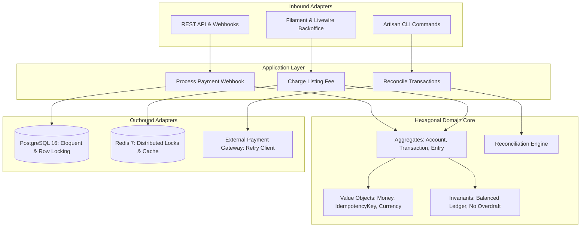

# AutoMarket: Hexagonal Architecture & Financial Ledger Showcase

[](#testing)
[](https://www.php.net/)
[](https://laravel.com)
[](https://filamentphp.com)
[](https://www.postgresql.org/)
[](https://redis.io/)

A production-grade automotive portal backend designed to demonstrate modern enterprise software engineering: **Hexagonal Architecture (Ports & Adapters)**, **Double-Entry Financial Ledger**, **Strict Idempotency with Distributed Locking**, **Resilient Network Retries with Exponential Backoff**, and an **Automated Data Reconciliation Engine** with an administrative backoffice in **Filament & Livewire**.

---

## 🏛️ 1. Architecture Overview (Ports & Adapters)

The project maintains a strict boundary separating business logic from framework and infrastructure details:



### Directory Structure

```
apps/backend/
├── src/
│   ├── Domain/                      # Pure PHP, 0 framework dependencies
│   │   ├── Shared/ValueObject/      # Money, Currency, IdempotencyKey
│   │   └── Finance/                 # Account, Transaction, Entry, Double-Entry rules
│   │       ├── Model/               # Account, Transaction, Entry, ReconciliationReport
│   │       ├── Exception/           # UnbalancedTransactionException, InsufficientFundsException
│   │       ├── Repository/          # LedgerRepositoryInterface (Outbound Port)
│   │       └── Service/             # ReconciliationEngine (Domain Service)
│   │
│   ├── Application/                 # Use Cases & Inbound/Outbound Ports
│   │   ├── Finance/Command/         # Command DTOs & Handlers
│   │   └── Finance/Port/            # PaymentGatewayPort, PaymentResult
│   │
│   └── Infrastructure/              # Technical Adapters
│       ├── Persistence/             # EloquentLedgerRepository with row locking
│       ├── Http/
│       │   ├── Controllers/Api/     # REST Controllers & Webhook Receivers
│       │   └── Middleware/          # EnforceIdempotencyMiddleware (Redis locks + DB store)
│       └── ExternalPayments/        # ResilientPaymentGatewayAdapter (Http::retry)
│
├── app/
│   ├── Filament/Resources/          # Backoffice panels (Accounts, Transactions, Reconciliation)
│   └── Console/Commands/            # ReconcileFinanceCommand
│
└── tests/                           # Comprehensive Pest Test Suite
    ├── Unit/Domain/                 # Pure domain math, invariants & rules
    ├── Feature/Finance/             # Atomic database transactions & race-condition protection
    ├── Feature/Idempotency/         # Concurrent locking & payload verification
    ├── Feature/Retry/               # Network resilience & duplicate webhook deduplication
    └── Feature/Reconciliation/      # Financial audit trail & discrepancy detection
```

---

## 🔒 2. Enterprise & Fintech Capabilities

### A. Strict Idempotency & Distributed Locking
* Every mutating operation requires an `Idempotency-Key` header.
* **Two-Phase Lock:** Acquires an atomic distributed lock in Redis (`idempotency_lock:{key}`).
* **Payload Verification:** Hashes `method + path + payload`. If the same key is reused with differing parameters, returns `422 Unprocessable Entity`.
* **Safe Concurrent Retries:** Concurrent requests while a job is processing return `409 Conflict`. Once completed, cached results return immediately (`X-Idempotency: HIT`).

### B. Double-Entry Financial Ledger
* Eliminates vulnerable single-column `balance` updates.
* Every business operation creates a balanced `Transaction` with at least two legs: **Debit** and **Credit**.
* Strict Invariant: **$\sum(Debits) - \sum(Credits) = 0$**.
* Account balances are updated atomically using PostgreSQL **pessimistic row locking (`lockForUpdate()`)** to eliminate lost updates.

### C. Network Resilience & Automated Retries
* HTTP client uses **Exponential Backoff with Random Jitter** (`base * 2^(attempt - 1) + jitter`).
* Selectively retries transient network failures (connection resets, 500, 502, 503, 504, 429), while failing fast on client errors (400, 422).
* Idempotent webhook consumer ensures repeated webhook delivery (up to 5x) credits funds exactly **once**.

### D. Automated Data Reconciliation Engine
* Periodically compares external payment gateway statements against internal ledger transactions.
* Classifies each transaction into:
  * `MATCHED`: External and internal records match perfectly.
  * `MISSING_INTERNAL`: Gateway captured funds, but internal system missed the webhook.
  * `MISSING_EXTERNAL`: Internal ledger recorded transaction, but payment gateway has no record.
  * `AMOUNT_MISMATCH`: Currency or amount differences (e.g. gateway fees, foreign exchange rounding).
* CLI Tool: `php artisan finance:reconcile` produces formatted audit tables.

---

## 🚀 3. Quickstart Guide

### Prerequisites
* Docker & Docker Compose

### Launching the Stack

```bash
# 1. Clone & enter directory
cd /home/lwaw/work/automarket

# 2. Start services (PHP 8.4, Nginx, PostgreSQL 16, Redis 7)
docker compose up -d

# 3. Seed demo data (Admin user, ledger accounts, transactions, reconciliation run)
docker compose exec -T backend php artisan db:seed
```

### Accessing the Administrative Backoffice (Filament)
* **URL:** [http://localhost:8000/admin](http://localhost:8000/admin)
* **Email:** `admin@automarket.local`
* **Password:** `password123`

---

## 🧪 4. Running the Pest Test Suite

```bash
# Run all Pest tests
docker compose exec -T backend ./vendor/bin/pest

# Run specific domain/feature suites
docker compose exec -T backend ./vendor/bin/pest tests/Unit/Domain/Finance
docker compose exec -T backend ./vendor/bin/pest tests/Feature/Idempotency
docker compose exec -T backend ./vendor/bin/pest tests/Feature/Retry
docker compose exec -T backend ./vendor/bin/pest tests/Feature/Reconciliation
```

---

## 👨‍💻 5. Author & Standards

* **Author:** Łukasz Wawrzyniak ([github.com/pontifex](https://github.com/pontifex))
* **Standards:** PSR-12, Strict Types, Domain-Driven Design (Tactical DDD), Clean Architecture.
